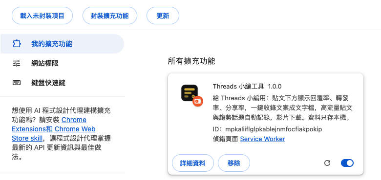

# Threads 小編工具（Chrome 插件）

給每天在 Threads 發文的小編、店家、創作者用的 Chrome 插件。裝好之後，在 threads.com 網頁上：

- 每篇貼文下面多一行 **回覆率／轉發率／分享率**（都是 ÷ 讚），綠、黃、灰三色，一眼看出哪篇真的紅。
- 看到想學的貼文按一下 **「收錄」**，存成文字檔，不用再截圖。
- 滑到的高流量貼文、搜尋頁的趨勢話題會自動記下來。

資料全部存在你自己的電腦。不登入、不上傳、不自動發文、不自動留言。

> 這是個人專案，與 Meta、Threads 無關。Threads 改版後它可能會壞，有更新會在作者的 Threads 上說。

## 安裝（三步）

沒有上架 Chrome 商店，用「載入未封裝項目」的方式安裝。

**1. 下載並解壓縮**

下載 [threads-editor-tool.zip](https://github.com/sojei1989/threads-editor-tool/releases/latest/download/threads-editor-tool.zip)（永遠是最新版），解壓縮後會得到一個資料夾 `threads-editor-tool`，裡面有 `manifest.json`。把這個資料夾放在不會刪掉的地方（例如「文件」）。

**2. 打開開發人員模式**

Chrome 網址列輸入 `chrome://extensions`，右上角把「開發人員模式」打開。


**3. 載入未封裝項目**

按左上角出現的「載入未封裝項目」，選剛才那個資料夾。列表出現「Threads 小編工具」就裝好了。



然後：
- 點工具列的拼圖圖示，把「Threads 小編工具」釘選出來。
- 重新整理 Threads 網頁。
- **關掉 Chrome 的「下載前詢問儲存位置」**（`chrome://settings/downloads`），不然每次自動存檔都會跳視窗。

以後要更新：重新下載 zip，解壓縮蓋掉原本的資料夾，到 `chrome://extensions` 按插件上的重新載入 ↻。

## 怎麼用

### 互動率
每篇貼文動作列下方一行：`回覆率 8.9%　轉發率 2.6%　分享率 158%`。

- 都是 ÷ 讚。別人貼文的曝光、觀看數 Threads 不給，所以只用這三個公開數字。
- 綠／黃／灰依門檻標色，門檻在彈窗的「設定」改。
- **讚少於 20 的貼文顯示「樣本小」**，不硬算比例（20 這條線可以改）。
- 數字還是畫面上的簡寫（例如「3.5 萬」）時，比例後面有「≈」；拿到精確數字就拿掉。
- 自己的貼文會多一個「觀看 N」，要先開過左側「洞察報告」頁才有。

### 收錄
按「收錄」變綠色「已收錄 ✓」，再按一次取消。存的是完整內文、四個數字、比例、主題標頭。

### 高流量與趨勢話題
- 滑到讚 ≥ 1,000 或回覆 ≥ 100 的貼文自動記進 `高流量.json`（門檻可改，最多留 500 筆）。
- 開「搜尋」頁會自動抄官方「最新趨勢話題」進 `趨勢話題.json`。

### 影片
有影片的貼文多一顆「影片」鈕，存到 Chrome 下載資料夾的 `Threads影片/`。只存本機、不轉發；請尊重原作者的著作權，只拿來自己參考。鈕是灰的代表還沒拿到網址，重新整理再試。

### 彈窗（工具列圖示）
收錄總數、最近 5 筆、今日高流量與話題數、「匯出」鈕、門檻設定、實際檔案路徑。

## 檔案存在哪
Chrome 下載資料夾底下的 `Threads收錄/`，改了會自動覆寫：

| 檔 | 內容 |
|---|---|
| `收錄.md` | 收錄的貼文，Markdown，可以直接丟給 AI 讀 |
| `收錄.json` | 同上，機器讀 |
| `高流量.json` | 自動記的高流量貼文 |
| `趨勢話題.json` | 搜尋頁抄來的趨勢話題 |
| `觀看數.json` | 自己貼文的觀看數（洞察報告頁） |

Chrome 的下載資料夾在 `chrome://settings/downloads` 改。

## 已知限制
- 別人貼文沒有觀看數（Threads 不給），這是平台限制不是 bug。
- Threads 改版可能讓那一行消失。選擇器都在 `content.js` 開頭的 `SEL`，照 `docs/DOM調查.md` 重查後改那裡。
- 只在 `https://www.threads.com/*` 生效，其他網站不會動。

## 隱私
不收集、不上傳任何資料；沒有伺服器、沒有帳號。權限只有 `storage`（本機存設定與資料）、`downloads`（把檔案寫到你的下載資料夾）和 threads.com 這一個網域。

## 給開發者
```bash
node --test tests/*.test.js
```

| 檔 | 做什麼 |
|---|---|
| `manifest.json` | MV3 宣告，只在 threads.com 生效 |
| `lib.js` | 純函式（數字解析、互動率、GraphQL 解析、Markdown） |
| `page-hook.js` | 頁面主世界：讀 Threads 自己的 GraphQL 回應與頁面內嵌 JSON，拿精確數字與影片網址（只讀已收到的資料，不發額外請求） |
| `content.js` | 找貼文、插鈕、互動率、收錄、高流量、抄趨勢與觀看數；選擇器都在開頭的 `SEL` |
| `background.js` | 存 chrome.storage、匯出到下載資料夾、影片下載 |
| `popup.html/.js` | 彈窗 |
| `style.css` | 注入樣式（節點都有 `data-tp`） |
| `icons/` | 圖示（原創，`icon.svg` 是源檔） |
| `docs/` | 設計、DOM 調查、實作計畫、每日排程提示詞（作者自己用 Claude Code 排程把高流量與趨勢整理成每日主題串，不在插件裡） |

## 作者與授權
Jeff（[Walllong 沃瀧居](https://sojei-exhibition.pages.dev)），平面設計、網站、Web App、影片剪輯。這個工具原本是做給自己用的。

MIT License，見 `LICENSE`。
